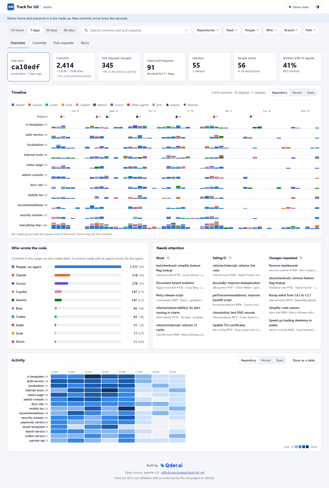
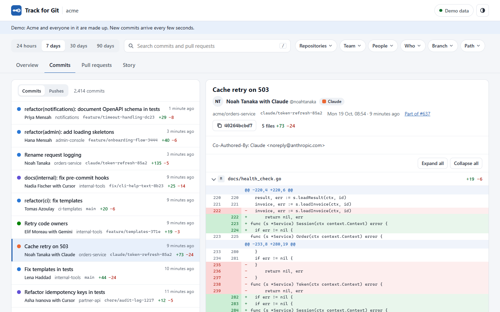
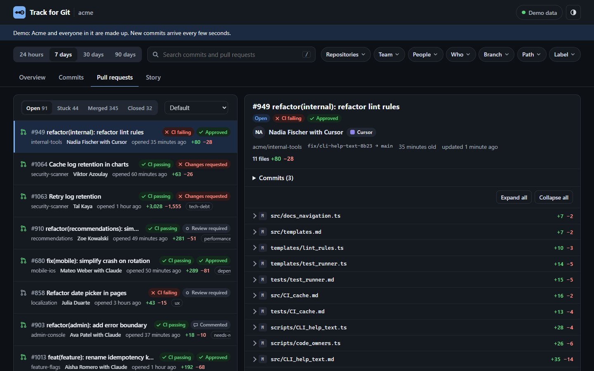
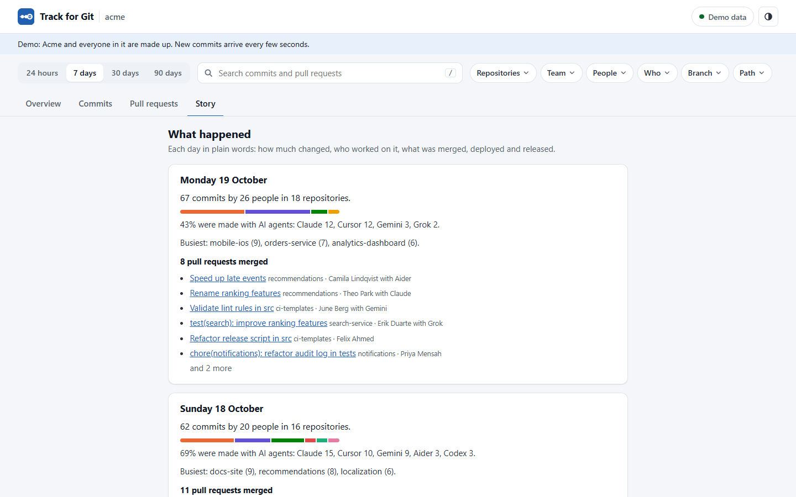
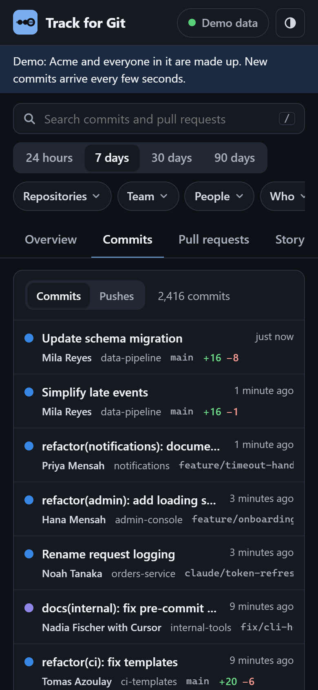
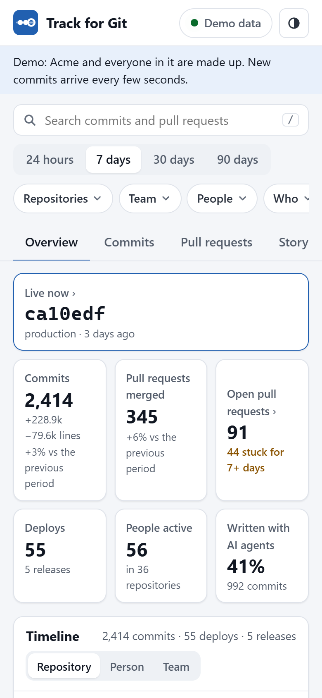
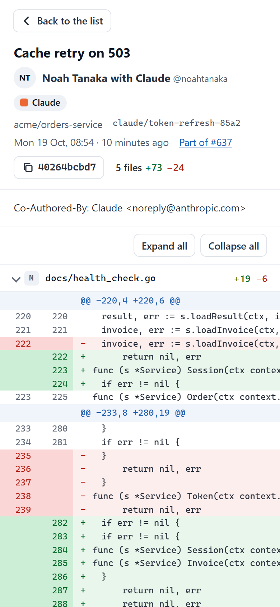

<h1>Track for Git</h1>

**Every commit, push and pull request across your GitHub organisation, as it happens: who made it (and with which AI
agent), what changed, what is stuck, and what shipped. On one calm page that managers and engineers both read.**

<picture>
  <source media="(prefers-color-scheme: dark)" srcset="docs/screenshots/desktop-dark-overview.png">
  
</picture>

<p>
  <a href="https://deploy.workers.cloudflare.com/?url=https://github.com/qderai/track-for-git"></a>
</p>

Big organisations push thousands of commits a day across hundreds of repositories. GitHub shows them one repository
at a time, in screens built for the person who wrote the code. Track for Git puts the whole organisation on one
timeline, in plain words, and stays fast and current while it does: GitHub's webhooks bring a push within seconds,
and polling inside GitHub's rate limits fills in the rest.

It is free and open source (Apache-2.0). You host it yourself on Cloudflare Workers + D1 in a few minutes, or in Node
or Docker anywhere else. It reads GitHub with read-only permissions. Your code activity stays in your own account,
behind your own sign-in.

## What you see

- **The whole organisation on one timeline.** Every repository (or the ones you choose), with lanes by repository,
  person or team. Each bar is split by who made the commits. Deploys from GitHub Deployments, releases and tags sit on
  the same line. Click a bar to read its commits.
- **Who wrote the code, people and agents.** Every commit and pull request says who made it, and with which AI agent:
  *Dana Levi with Claude*, *Copilot*, *Ruth Ben with Cursor*. Claude, Cursor, Codex, Copilot, Grok, Gemini, Devin,
  Jules, Aider, Windsurf, Amp and others are recognised out of the box, and you can add your own
  ([below](#make-your-agents-visible)). See what share of the code each one wrote, filter by it, and follow it over
  time.
- **Pull requests a manager can act on.** Open, stuck (no activity for 7 days, configurable), merged and closed. Each
  shows its review state, CI status, age and size. *Needs attention* lists what is stuck, what fails CI and what waits
  on requested changes.
- **Readable changes.** For every commit and pull request: the files, the lines added and removed, and a clean diff
  with line numbers. Lock files and generated code start folded. Long diffs draw a few hundred lines at a time, so a
  10,000-line change never freezes the page.
- **Activity heatmaps** by repository, person or team, per day in each viewer's own time zone (or the team's, with
  `TIME_ZONE`). Each one can also be read as a table.
- **What is live now**: the commit your newest successful deploy shipped, one click from its diff.
- **The Story**, for people who do not read diffs: each day in plain sentences. How much changed and by whom, the
  busiest repositories, the pull requests merged, what was deployed and released.
- **Filters that stay in the link.** Repository, team, person, agent, branch, path, label and free-text search. Any
  view can be shared as a URL.

<table>
  <tr>
    <td width="50%"></td>
    <td width="50%"></td>
  </tr>
  <tr>
    <td></td>
    <td>
      
      
      
    </td>
  </tr>
</table>

Light and dark, keyboard-navigable throughout, screen-reader labelled, built to WCAG 2.1 AA, English UI with every
string in one file for translation. Every picture here comes from the built-in demo organisation: the people, the
company and the code are made up.

## Quick start

**Try it in one minute, with no token:**

```sh
git clone https://github.com/qderai/track-for-git && cd track-for-git
npm run demo            # http://localhost:8787: Acme, a made-up organisation, with commits arriving live
```

(Node 22.13 or later; there is nothing to install for the demo.)

**Run it for your organisation:** press **Deploy to Cloudflare** above, or:

```sh
npm install
npx wrangler login
npm run deploy          # creates the D1 database, applies the migrations, deploys the Worker
```

Then follow the **[one-page setup](docs/setup.md)**: connect GitHub with a read-only GitHub App (or a fine-grained
token), add the webhook, put the dashboard behind Cloudflare Access or "members of this organisation only" GitHub
sign-in, and turn the demo off.

**Not on Cloudflare?** `docker compose up`, or `node server/node.js`: the same app on SQLite (built into Node), with
the same settings.

**Inside an app you already run?** Mount it at a path of that app with `track-for-git/embed`: the page, its API
and the sync on your own Worker, database and sign-in, with your own deploys on the timeline and a *Live now* tile.
See [Inside an app you already run](docs/setup.md#inside-an-app-you-already-run).

## Make your agents visible

Track for Git recognises an AI agent by the marks agents already leave: its own account (`copilot-swe-agent[bot]`,
`devin-ai-integration[bot]`), the `Co-authored-by:` trailer many agents add (Claude Code does by default), a footer such as "Generated with Claude Code", or, for a member's pull request, the branch prefix it uses
(`claude/`, `codex/`, `cursor/`). Names are matched whole, so *Claude Monet* and *Devin Smith* stay people. A branch
name is never evidence on a public fork.

**Any other agent shows up under its own name** when its commits carry one of these trailers:

```
Assisted-by: Acme Coder
Generated-by: Acme Coder
AI-Agent: Acme Coder
```

**Your company's own agents**, with their own accounts or addresses, go in the `AGENTS` setting:

```json
[{ "id": "forge", "name": "Forge", "logins": ["forge-agent[bot]"], "emails": ["@agents.acme.example"], "names": ["Forge"], "branches": ["forge/"] }]
```

The six most common agents keep fixed colours, so a colour always means the same agent. Others share "Other agents"
in the charts but keep their own names everywhere else. The rules are in [`src/agents.js`](src/agents.js): a pull
request adding an agent is very welcome.

## How it works

```
GitHub ──webhook (HMAC-SHA256)──▶ ┐
                                  ├──▶ Worker ──▶ D1 (metadata only) ──▶ the page (static, no framework)
GitHub ◀──GraphQL + REST, read-only, every minute──┘        └──▶ diffs on demand, cached, never stored
```

- **Real time:** webhooks for pushes, pull requests, reviews, checks, deploys, releases and tags. Every delivery is
  checked against its signature. Redeliveries are handled once. Repositories you do not watch are ignored.
- **Polling as the fallback and the backfill**, from a cron trigger once a minute. It lists the organisation's
  repositories newest-push first (an unchanged list costs nothing thanks to ETags), and touches only the repositories
  that changed. It asks GraphQL about five at a time in one request: their new commits with line counts, their pull
  requests with review decision and CI, their deploys, releases and tags. REST then fetches the pushes to other
  branches. Every answer's rate limit is read, a 10% reserve is kept for people opening diffs, and on a 403/429 it
  waits for the reset. With hundreds of repositories, a quiet minute usually costs one conditional request, which
  GitHub does not count against the limit.
- **Stored:** commit and pull request metadata (who, when, which repository and branch, how many lines, which paths),
  for 180 days by default. **Never stored:** diffs and file contents. They are fetched from GitHub when someone opens
  a commit and kept only in the HTTP cache.
- **Fast with thousands of commits a day:** every list is paginated with a keyset cursor and virtualised in the page
  (only the rows on screen exist). Answers are computed once every few seconds for everyone. Charts are aggregated in
  SQL, in the viewer's time zone, daylight saving included.

## Security and privacy

- Read-only GitHub permissions. The only POSTs to GitHub are GraphQL queries, the App's token exchange and the
  sign-in's code exchange.
- The dashboard **refuses to show any data until you choose who may open it** (`AUTH`). With Cloudflare Access, the
  Worker also verifies Access's signed token on every API request. With GitHub sign-in, membership is checked with the
  dashboard's own credentials, and the person's GitHub token is dropped after sign-in.
- Secrets are only ever environment secrets. They are never shown, logged or stored in the database.
- A strict Content Security Policy: the page loads nothing from any other origin (no CDN, no fonts, no avatars), and
  every message, name and line of code is inserted as text.
- Found a problem? See [SECURITY.md](SECURITY.md).

## Development

```sh
npm test                 # node:test, against real SQLite with the real migrations
npm run demo             # the app on Node with the demo
npm run dev              # the app on wrangler dev with a local D1 (DEMO=1 by default)
npm run screenshots      # the README's pictures (needs playwright-core and Chrome)
npm run build:embed      # after changing public/: src/embed-assets.js, the page for track-for-git/embed
```

```
src/          the Worker: app.js (routes), sync.js (polling), webhook.js, queries.js (the read side), agents.js,
              auth.js, demo.js, embed.js (mounting inside another app), github/ (client, App sign-in, GraphQL,
              payloads into rows)
public/       the page: no framework, no build; js/, styles.css, locales/en.js (every word)
server/       Node and Docker
migrations/   D1 / SQLite schema
```

To translate the page, copy `public/locales/en.js`, translate the values, and add the language in `public/js/i18n.js`.

## License

Apache-2.0, copyright 2026 Qder AI. See [LICENSE](LICENSE) and [NOTICE](NOTICE). The Qder.ai name and logo are
trademarks of Qder AI and are not covered by the license.

Track for Git is not affiliated with or endorsed by the Git project or GitHub. Git is a trademark of the Software
Freedom Conservancy; GitHub is a trademark of GitHub, Inc.

<br>
<p>
  <a href="https://qder.ai">
    <picture>
      <source media="(prefers-color-scheme: dark)" srcset="public/brand/qder-lockup-ltr-white.svg">
      
    </picture>
  </a>
  <br>
  <sub>Built by <a href="https://qder.ai">Qder.ai</a>. We built it for ourselves first, to watch our own engineers
  and agents ship, then opened it up.</sub>
</p>
